# VoiceLnq

**Open-source dictation for your computer and your Android phone that spells your own words right.**

VoiceLnq was called VoiceFlow until November 2026.

You speak in any app and VoiceLnq types it, spelling names and jargon the way your word list says. The list is a few plain files you own. Edit them yourself or let an AI job fill them from your notes, then sync them through a private GitHub repository or a small server you run. You bring your own API keys, and there is no VoiceLnq account.

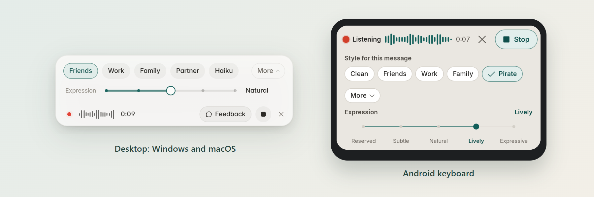

> **No published downloads yet.** Both apps are built from source for now ([Getting started](#getting-started)). To hear when installers and APKs land, **Star** and **Watch → Custom → Releases** this repository.

<!-- Blog post about the experiment behind VoiceLnq: add the link here once it is published. -->

## The two apps

| | **Desktop** | **Android keyboard** |
|---|---|---|
| **Runs on** | Windows; macOS (built by CI) | Android 8.0 and newer |
| **How you dictate** | Press a hotkey in any app, speak, press it again. The text is pasted at your cursor | Tap **Dictate** on the keyboard, in any app |
| **Tidy-up** | Styles and an expression level, chosen on the recording bar | Styles and an expression level, chosen on the keyboard while you speak |
| **Your word list** | From a folder (local, a network share or a Google Drive folder) or a private GitHub repository | From a private GitHub repository (from 0.9.2) or a self-hosted [sync gateway](sync/README.md) |
| **On `main`** | 0.9.20 | 0.9.2 |
| **Licence** | AGPL-3.0 (a fork of [Whispering](https://github.com/EpicenterHQ/epicenter)) | MIT |
| **Full docs** | [`desktop/README.md`](desktop/README.md) | [`docs/android/README.md`](docs/android/README.md) |

## How it works

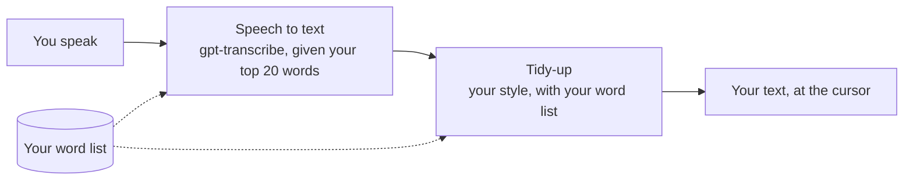

1. **Speech to text.** OpenAI's `gpt-transcribe` hears the recording, with your 20 most important words sent as hints.
2. **Tidy-up.** A text model removes filler, fixes punctuation and applies your style. It also gets your word list, so it can fix a word that was misheard.
3. **Your text** goes into the app you were using.

The 20-word limit is the desktop's. The Android keyboard follows the same steps with OpenAI speech models. Without synced word lists, it sends the phone's own list as hints and leaves the word list out of the tidy-up.

**Why 20 words?** We measured it on one speaker's recordings ([results](bench/vocab/results/real/summary.md)):

- The script had seven invented names, each said twice. With no word list, `gpt-transcribe` got 3 of those 14 mentions right. With 20, 40 or 50 words it got all 14; with 80, it got 12 (the median of three runs).
- The tidy-up can over-correct. The default model changed 3 of 10 correctly heard everyday words (Docker, Beeper, Miro) into listed names that sound like them. Fixes for this were tested ([tidy-up fixes](bench/vocab/results/tidy-fixes/summary.md)) and are not in the app yet.

The test, its limits and how to rerun it are in [`bench/vocab`](bench/vocab/README.md).

## Desktop

Hotkey dictation for Windows and macOS, with your own OpenAI key. Transcription uses `gpt-transcribe` by default, and you can type another OpenAI model id in Settings.

- **The recording bar** floats above your apps while you speak. Pick a style for this one message and set how expressive it should be, from Reserved to Expressive.
- **Paste anywhere.** The text is pasted at your cursor. If it can't be pasted, it goes to the clipboard and the bar says so.
- **The Feedback window** lets you fix the text you just got and save changes for next time, such as a spelling or a style that should be more casual. **Find fixes** asks a model you choose (OpenAI or Anthropic; with an Anthropic key it defaults to Claude Opus 5.5).
- **Word lists** come from a folder or a private GitHub repository. **Connect GitHub** signs in with a short code, with no token to copy.
- **Vocabulary** shows every word and spelling, where each came from, and lets you add your own.

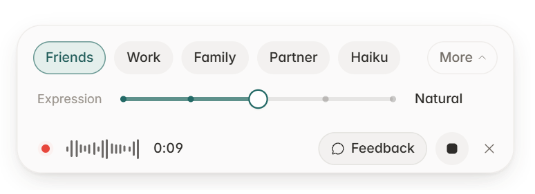

| | |
|---|---|
| 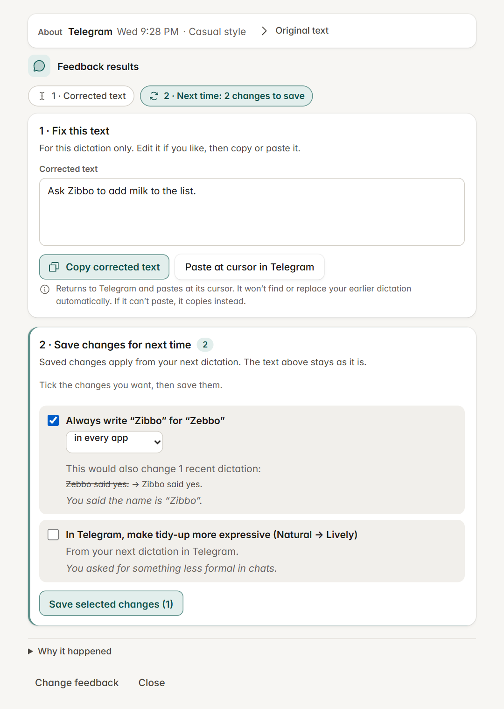 | 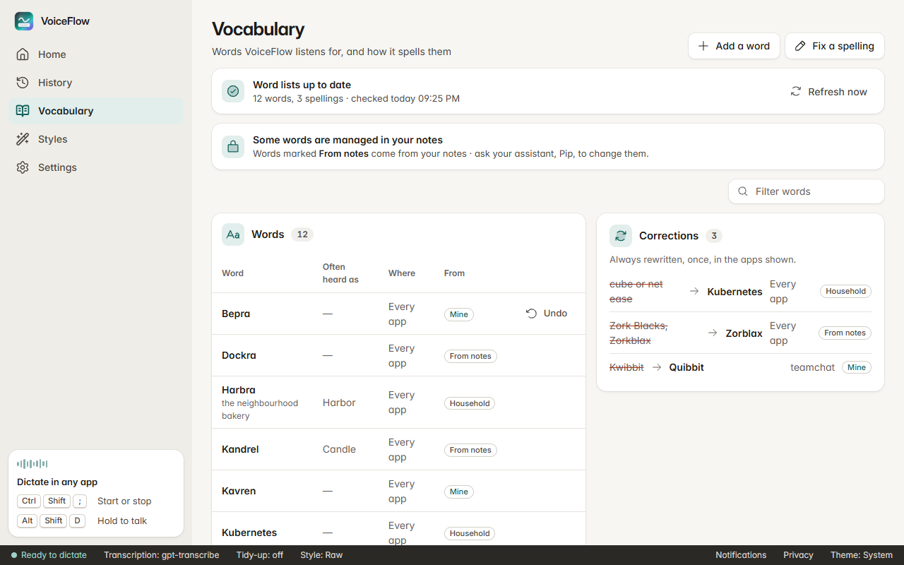 |

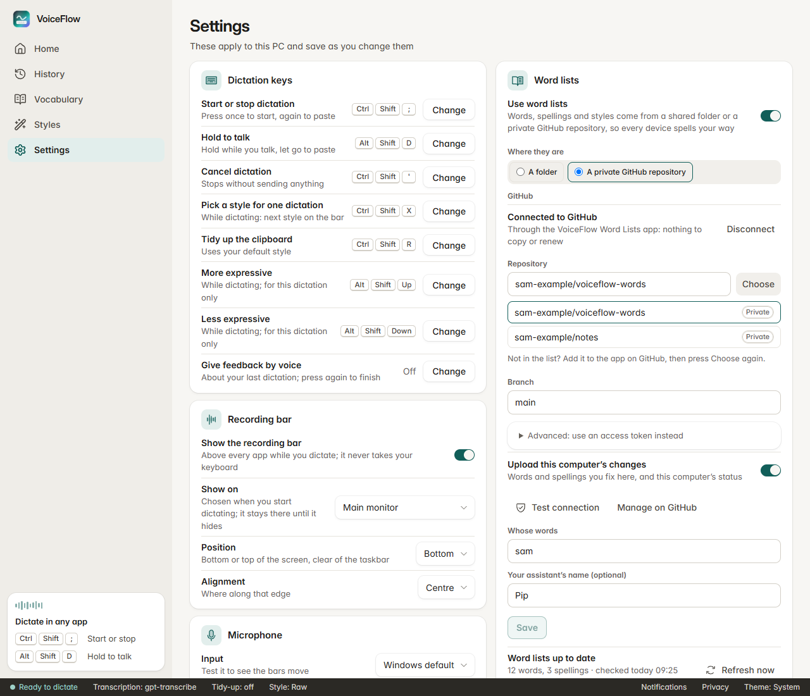

## Android keyboard

A full keyboard with dictation built in. It works in any app that takes a normal keyboard.

- **Dictate** records the whole message, then inserts the tidied text.
- **While you speak**, the keys give way to a panel of style chips and an expression slider. The choice is for that message only.
- **Providers:** OpenAI, xAI (Grok) or Deepgram for speech, OpenAI, xAI or Anthropic for tidy-up, or offline speech models (Vosk, Parakeet) that keep audio on the phone.
- **Your words:** a personal word list on the phone, plus your shared word lists from a private GitHub repository or a [sync gateway](sync/README.md). The phone reads the shared lists and sends back no word edits.
- **Chinese pinyin** on a full keyboard or a nine-key pad, with a **language key** to switch.
- **Folding phones:** on a wide screen the keyboard splits in two.
- Also: an emoji picker, a number pad for number fields, a Paste chip and a history of recent dictations.

| | |
|---|---|
| 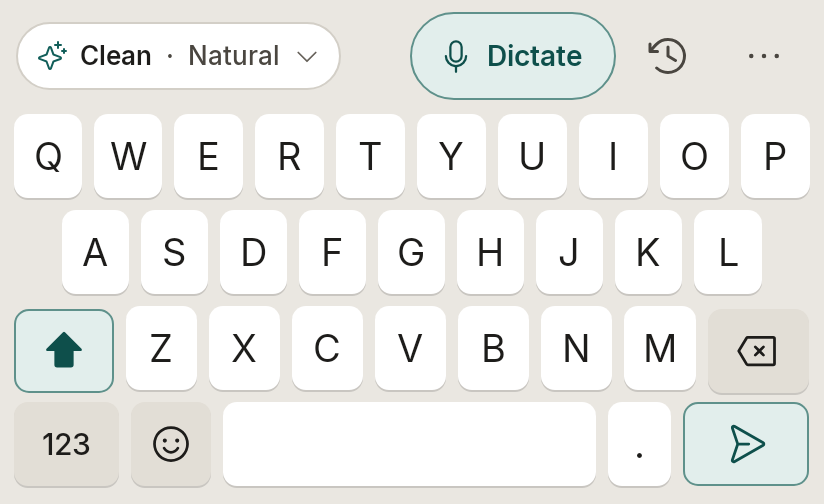 | 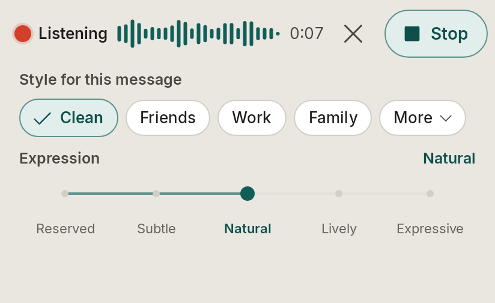 |
| 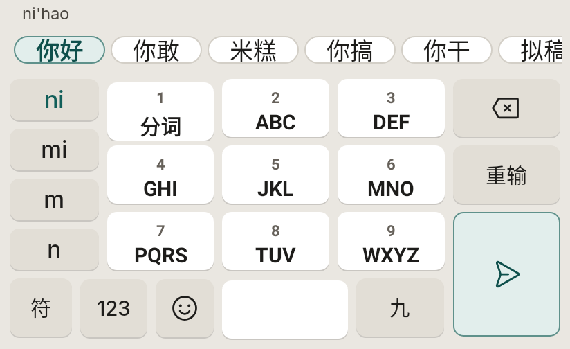 | 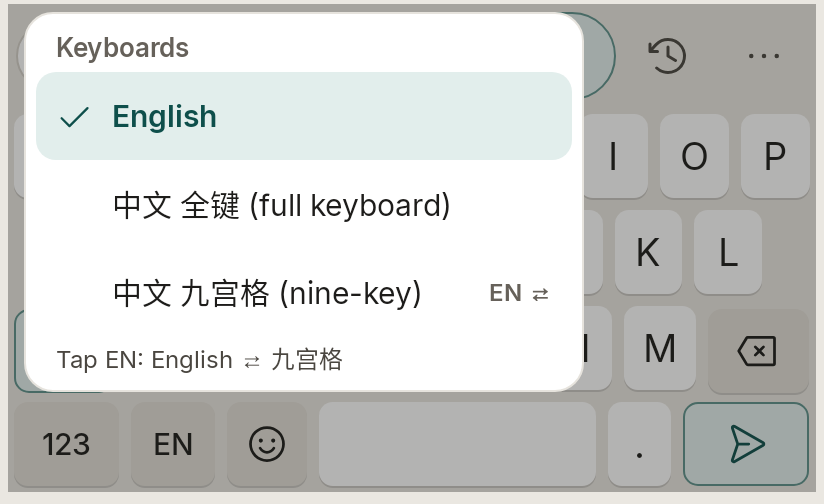 |

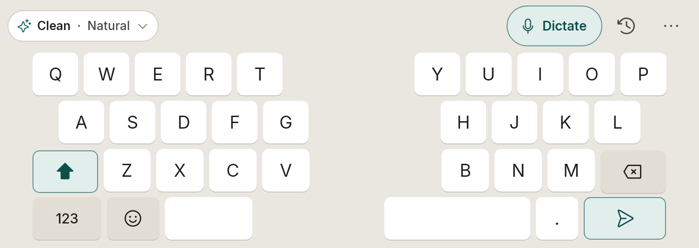

**New in Android 0.9.2:**

- Rime (librime) as the Chinese engine.
- Word lists from a private GitHub repository, read-only, with **Connect GitHub**.

## Your words, kept in sync

The word list is a few JSON files: words everyone in a household shares, words an AI job writes from your notes, and your own. Each device keeps a last good copy, so your words still apply when the folder or repository can't be reached.

| Where the list lives | Desktop | Android | Guide |
|---|---|---|---|
| A private GitHub repository | Yes, with **Connect GitHub** | Yes, from 0.9.2, read-only, with **Connect GitHub** | [`docs/GITHUB-SYNC.md`](docs/GITHUB-SYNC.md) |
| A folder (local, network share or Google Drive) | Yes | No | [`docs/desktop/GOOGLE-DRIVE.md`](docs/desktop/GOOGLE-DRIVE.md) |
| A sync gateway you run | Reads the gateway's folder directly | Yes, read-only | [`sync/README.md`](sync/README.md) |

- **An AI job can keep it current.** Any assistant that can edit files can add the names from your notes. With GitHub, every change it makes is a commit you can review or undo. Give it the rules in [Connect your own AI](docs/desktop/CONNECT-YOUR-OWN-AI.md).
- **The format** is in [`pack/README.md`](pack/README.md), with a [template](pack/template/) to start from.
- The Google Drive guide is tested against a local folder laid out the same way, not yet against a real Drive folder.

## Getting started

There are no published downloads yet, so you build each app from source. Clone with long paths on (needed on Windows):

```sh
git clone -c core.longpaths=true https://github.com/yutungh/voicelnq
```

- **Desktop:** you need Bun, Rust and, on Windows, the Visual Studio C++ build tools. Steps: [`desktop/README.md`](desktop/README.md#build-and-run). On first run it asks for your OpenAI key.
- **Android keyboard:** you need JDK 17 and the Android SDK (platform 35). Run `./gradlew assembleDebug` (`.\gradlew.bat assembleDebug` on Windows), install the APK with `adb`, then enable **VoiceLnq Keyboard** in Android's keyboard settings. Steps: [`docs/android/README.md`](docs/android/README.md#build).
- **Word lists** are optional. Both apps work without them.

**Stay in the loop:** Star and **Watch → Custom → Releases** to hear when downloads land.

## Privacy

You use your own API keys, and requests go straight from your device to the provider you chose. Nothing passes through a VoiceLnq server, and neither app sends telemetry.

| What | Where it goes |
|---|---|
| Your recording | The speech provider you chose, after you stop. Offline models keep it on the device |
| Your top words | The speech provider, with the recording, as spelling hints (OpenAI models that accept them) |
| The transcript and your word list | The tidy-up provider you chose |
| Text you ask the Android keyboard to rewrite or spell-check | The tidy-up provider you chose |
| One dictation, your note and its context (matching words and spellings, the app name, the style) | The model you chose, only when you click **Find fixes** (desktop) |
| Your word lists | Read from your folder, your GitHub repository (`api.github.com`) or your sync gateway. Desktop uploads its word edits and a status file there unless you turn uploads off. The phone sends its gateway a status report (app version and counts), not word edits |

Where things are kept:

- **API keys:** Windows Credential Manager or the macOS Keychain on desktop. On Android they're in the app's private preferences (encrypted storage is on the roadmap).
- **History and recordings** stay on the device.
- **Word lists** stay in your folder or repository, with an offline copy on each device.

Details: [`PRIVACY.md`](PRIVACY.md) (Android) and [Network calls](desktop/README.md#network-calls) (desktop).

## Roadmap

Next:

- **Prebuilt downloads:** installers for Windows and macOS, and APKs, built by CI.
- **Phone edits flowing back:** today words you fix on the phone stay on the phone.
- **Per-app built-in styles,** such as a casual style in chat apps and a formal one in email.
- **A new tidy-up default** that stops over-correcting sound-alike words (the fixes measured in [`bench/vocab`](bench/vocab/results/tidy-fixes/summary.md)).

Not there yet: VoiceLnq has no MCP server.

## Contributing

Issues and pull requests are welcome. Start with [`CONTRIBUTING.md`](CONTRIBUTING.md). This repository is public, so [`AGENTS.md`](AGENTS.md) sets the privacy rules for every change: invented names and sentences only, in code, tests, docs and screenshots.

## Credits

- **The desktop app is a fork of [Whispering](https://github.com/EpicenterHQ/epicenter)** 7.11.0 by Braden Wong, part of the Epicenter project (AGPL-3.0, version 3 only). VoiceLnq is not affiliated with or endorsed by the Whispering project. What changed is in [`desktop/NOTICE`](desktop/NOTICE) and [`desktop/CHANGELOG.md`](desktop/CHANGELOG.md).
- **Chinese pinyin dictionary:** [Wanxiang](https://github.com/amzxyz/rime-wanxiang) (万象拼音) by amzxyz, CC BY 4.0, adapted (changes listed in [`third_party/README.md`](third_party/README.md)).
- **English word frequencies:** SymSpell (MIT, Wolf Garbe), built from Google Books Ngram (CC BY 3.0) and SCOWL/ESDB (Kevin Atkinson).
- **Offline speech on Android:** Vosk and sherpa-onnx.
- **Inter** typeface (SIL Open Font License 1.1), **Phosphor** icons (MIT) and **Unicode** emoji data (Unicode License v3).

Pinned revisions and licence texts for the bundled data and artwork are in [`third_party/`](third_party/README.md), and the Android app shows them under Settings > Open-source credits.

VoiceLnq is not affiliated with Typeless, Voiceflow, Apple, Google, Anthropic or OpenAI.

## Licences

Each folder's licence covers only that folder.

| Part | Licence |
|---|---|
| Android keyboard (repository root, `app/`) | MIT ([`LICENSE`](LICENSE)) |
| Desktop app (`desktop/`) | AGPL-3.0, version 3 only ([`desktop/LICENSE`](desktop/LICENSE)) |
| Word-list format (`pack/`) | MIT ([`pack/LICENSE`](pack/LICENSE)) |
| Sync gateway (`sync/`) | MIT |

The apps share data (the word-list format), never code. Don't copy code from the AGPL desktop app into the MIT parts.
