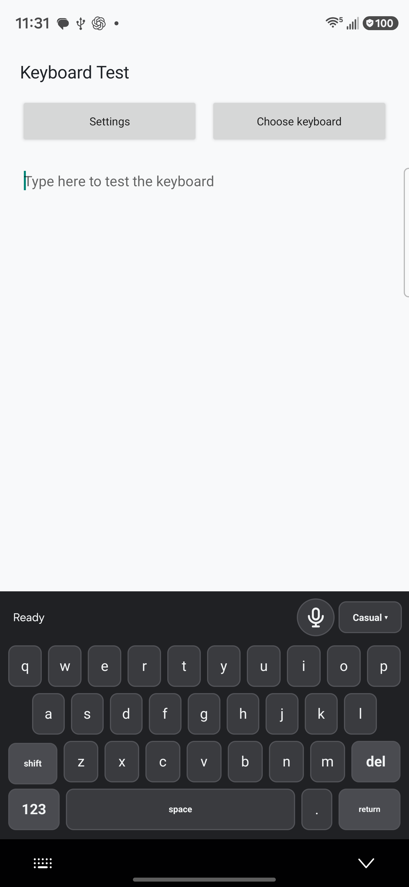
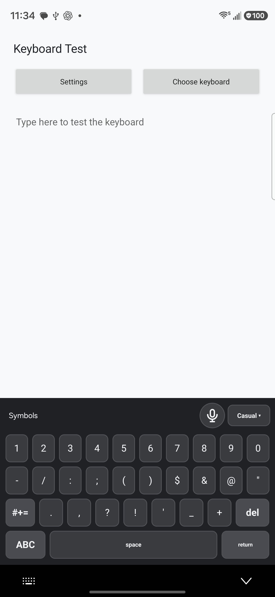
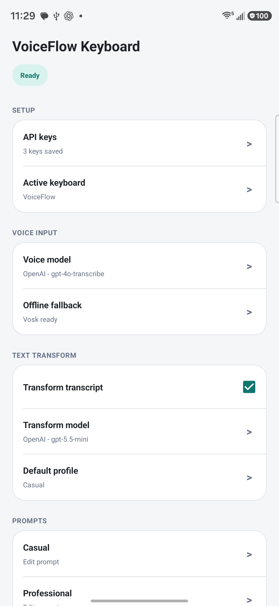
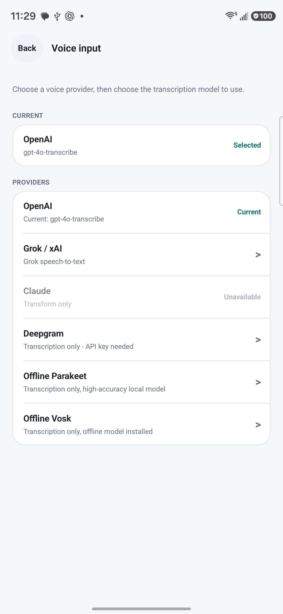
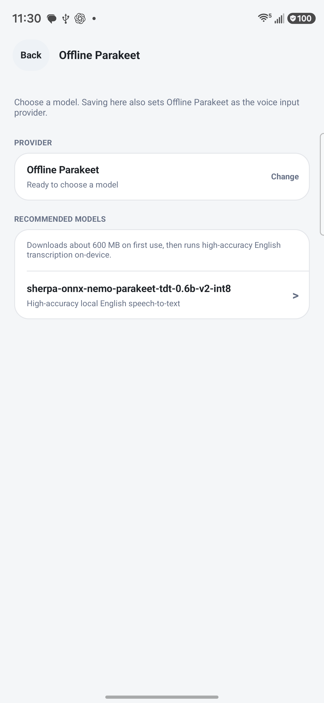

# VoiceFlow Keyboard

Open-source Android voice keyboard for people who want a Typeless-style mobile dictation workflow, AI dictation cleanup, and bring-your-own-key voice-to-text on any Android phone.

Record a voice note from the keyboard, transcribe it, optionally clean it with an LLM prompt, and insert the final text into any app. VoiceFlow Keyboard is a native Android IME, so it works anywhere a normal keyboard works: chat apps, email, notes, search, docs, forms, and coding tools.

> Not affiliated with Typeless, Voiceflow, Apple, Google, Anthropic, or OpenAI. "Typeless-style" is used only to describe the product category: voice-first mobile typing with AI cleanup.

## Screenshots











## Try It

Download the latest prototype APK from the [GitHub Releases page](https://github.com/yutungh/voiceflow/releases). Open the latest release, download the `voiceflow-keyboard-...-debug.apk` asset, then install it on your Android phone.

This is a debug-signed prototype build for sideloading and testing. For production use, build and sign your own release APK.

Release APKs are built by GitHub Actions from the public repository. They do not include `.env.local` and do not bundle any API keys.

## Why This Exists

Most mobile voice typing tools either insert raw dictation immediately or live inside one app. This project is a base for an Android keyboard that can:

- capture a full recording instead of live-inserting partial text,
- transcribe the recording,
- rewrite or lightly clean the transcript with a configurable prompt,
- insert the final result into the active text field,
- let users bring their own API key and model choices.

Good search terms for this project: Android voice keyboard, VoiceFlow Keyboard, Typeless alternative for Android, AI dictation keyboard, AI voice keyboard, OpenAI transcription keyboard, Grok transcription keyboard, Claude cleanup keyboard, offline voice typing Android, Parakeet offline transcription Android, Vosk offline keyboard, voice-to-text IME, prompt-based dictation cleanup, bring your own API key keyboard.

## Features

- Native Android input method service.
- Apple-inspired key layout and spacing.
- Permanent microphone button above the keys.
- Whole-clip recording: record first, transcribe after stop, then insert.
- OpenAI audio transcription via `/v1/audio/transcriptions`.
- Grok/xAI speech-to-text and transform support.
- Claude/Anthropic transform support.
- Deepgram speech-to-text support.
- Optional local offline transcription with compact Vosk or high-accuracy Parakeet via sherpa-onnx.
- Automatic offline transcription fallback when a cloud voice provider is selected but the phone has no validated internet connection.
- Settings control to download the compact offline fallback model before you need it.
- Optional transcript cleanup via configurable cloud transform providers.
- Editable API keys, providers, transcription models, transform models, and voice styles.
- Combined provider/model pickers for voice input and text transform setup.
- Voice styles: Friends, Work, and Family by default, an optional Partner template, editable custom styles, optional emoji icons, and a collapsed Fun group with Haiku, Pirate, Shakespearean, Noir Detective, and Wizard personas.
- A mutually exclusive style picker replaces the disabled keys while dictation or translation is recording.
- A five-step expression control (`Reserved` through `Expressive`) adjusts conversational energy, punctuation, and permitted emoji use independently for each voice style.
- Voice styles apply to both transcript cleanup and natural target-language localization; voice instruction mode remains independent.
- Friends and Work automatically use bullets or numbering when the transcript is clearly a list, steps, tasks, instructions, options, or grouped items.
- Translation history remembers the target language and generated style variants for comparison or reuse.
- Retone can regenerate the last inserted dictation or translation from its original transcript, safely replace it when the field is unchanged, and keep alternate style/expression versions together in history.
- Low-latency GPT-5 transform settings with safe fallback retry.
- Non-destructive English spelling and completion suggestions; spelling candidates are never applied unless the user taps one.
- Personal vocabulary supports multiple likely mishearings, an exact output, and optional context for names, nicknames, jargon, and commands.
- GPT Transcribe receives personal exact spellings as keyword hints, while a provider-independent local correction guarantees configured output such as `N P M run pre flight` -> `npm run preflight`.
- Built-in phrase replacement example: `Cloud Code` -> `Claude Code`.
- Smart spacing for voice inserts.
- Every new input target and keyboard window opens on the layout its field type calls for (letters for text, the number pad for number and phone fields, symbols for dates and times), even when Android reuses the same keyboard view across app switches. A layer chosen by hand survives the same field restarting, as some code fields do after every digit, but never carries into a different field. A default-on safety setting cancels and discards active recordings when the keyboard closes or the input app changes.
- Phone-style number pad with the extra keys each field needs (`+ * #` for phone numbers, `.` and `-` where a number field allows them, none for a PIN), an ABC key to leave it, and a `1234` key on the symbols layer to open it by hand for code or card fields an app did not mark as numeric.
- Paste chip: text copied in the last two minutes is offered as a one-tap Paste, typed as-is, which also works in apps that block their own paste menu. Password fields always offer copied text for password managers; nothing is offered on the lock screen. The history panel always has a Paste clipboard button.
- Holding delete removes characters, then whole words after 3 seconds, then everything before the cursor after 6 seconds.
- Backspace straight after a phrase replacement restores what you typed.
- Active cellular and VoIP calls are detected before recording so Android's microphone restriction is explained instead of silently producing an empty transcript.
- Compact recording and retone statuses use adaptive sizing and marquee overflow so the full state remains readable.
- Short voice outputs under 5 words do not get a forced trailing period.
- Haptics for keyboard taps.
- Symbols and expanded symbols views.
- Emoji key immediately left of the space bar, available in letters, Chinese, and symbols layouts.
- Offline emoji picker with nine categories, recent picks, English keyword search, and long-press skin-tone choices. Search has its own typing keys and never inserts the query into the active app.

## Emoji Keyboard

Tap **☺** beside the space bar to browse emojis. Tap a category to filter the grid, or tap **Search emojis** and type a name or keyword such as `happy`, `birthday`, or `dog`. Matching emojis appear above the search keys; **Done** expands the results. Hold an emoji to choose an available skin tone. **ABC** returns to typing, and Back first closes search, then the picker.

The bundled Unicode 16.0 catalog works offline and uses the phone's emoji font, so the appearance and support for newer emojis depend on Android/the installed font. Recent picks stay on the device; password fields and editors that disable personalized learning do not add to recents. Backspace removes complete catalog emoji sequences, including families, flags, and skin tones, once the picker has loaded.

GIF browsing is not included in this version. A future integration can use [GIPHY's search and trending API](https://developers.giphy.com/docs/api/) with a developer key and the required attribution. Android's [image keyboard API](https://developer.android.com/develop/ui/views/touch-and-input/image-keyboard) can insert GIF content into compatible apps; unsupported editors would need an explicit link fallback. [Tenor discontinued its third-party API on June 30, 2026](https://support.google.com/tenor/answer/10455265?hl=en).

To regenerate the emoji asset from the pinned sources:

```text
python scripts/build-emoji-catalog.py
```

## Current Status

This is a working prototype and a base for other developers, not a finished consumer keyboard.

Known tradeoffs:

- API keys are stored locally in app preferences. For production, migrate to encrypted storage.
- Audio is sent to the configured transcription provider when using OpenAI transcription.
- Realtime streaming transcription is not implemented yet. Cloud transcription records the full clip and uploads after stop.
- Offline Vosk transcription downloads a compact local model on first use and runs the transcription on-device after recording stops.
- Offline Parakeet downloads a much larger local model, about 600 MB, on first use. It is intended as the higher-accuracy offline English option.
- Offline fallback uses an installed Parakeet model first, then an installed Vosk model. Use Settings > Voice input > Offline fallback to prepare the compact Vosk fallback before you need it.
- English spelling suggestions are context-free and much simpler than Gboard or Apple Keyboard, so they are never applied automatically.
- The UI is tuned for a modern Samsung/Android phone but is not exhaustively tested across devices.

## Build

Requirements:

- Android Studio or Android SDK
- JDK 17+

Build the debug APK:

```powershell
.\gradlew.bat assembleDebug
```

On macOS/Linux:

```bash
./gradlew assembleDebug
```

Output:

```text
app/build/outputs/apk/debug/app-debug.apk
```

## Install On A Phone

Enable Developer Options and USB Debugging on your Android phone. On Samsung devices, you may also need to disable Auto Blocker for sideloading.

If you downloaded an APK from Releases, install that APK:

1. Go to [Releases](https://github.com/yutungh/voiceflow/releases).
2. Download the APK asset named like `voiceflow-keyboard-vX.Y.Z-debug.apk`.
3. On your phone, open the APK and allow install from that source if Android asks.
4. Open **VoiceFlow Keyboard** from the app drawer.

If you built from source, install the generated debug APK:

Install:

```powershell
adb install -r app/build/outputs/apk/debug/app-debug.apk
```

Then:

1. Open **VoiceFlow Keyboard**.
2. Grant microphone permission.
3. Add your provider API keys if using cloud transcription or cleanup.
4. Choose your voice input model and transform model.
5. Open Android keyboard settings and enable **VoiceFlow Keyboard**.
6. Choose it from the keyboard picker.

## Private Local Install

For a personal phone build, you can keep API keys in an ignored `.env.local` file and seed them into the installed app preferences after install:

```powershell
.\gradlew.bat assembleDebug
.\scripts\install-private.ps1 -Serial YOUR_DEVICE_SERIAL
```

Supported local key names:

```text
OpenAIAPIKey=...
AnthropicAPIKey=...
XAIAPIKey=...
DeepgramAPIKey=...
```

Personal installations can also use an ignored `.voiceflow-private.json` file to preserve private vocabulary without committing it:

```json
{
  "replacements": [
    {
      "from": "likely mishearing\nanother mishearing",
      "to": "ExactSpelling",
      "context": "Optional private context for GPT Transcribe."
    }
  ]
}
```

The private installer merges entries by exact-output name, so rerunning it updates those private terms without removing unrelated replacements added in Settings.

This script does not compile keys into the APK. It installs the local debug APK, then writes the keys directly into the connected device's private app preferences with `adb run-as`.

## Recommended Model Setup

The default OpenAI flow is:

- transcription: `gpt-transcribe`
- transform: a GPT-5 model

The transform request uses low-latency options for GPT-5-style cleanup tasks:

- `reasoning.effort: none`
- `text.verbosity: low`
- prompt caching key/retention
- fallback retry without optional latency fields if a selected model rejects them

Provider support:

- OpenAI: transcription and transform.
- Grok / xAI: transcription and transform.
- Claude / Anthropic: transform only.
- Deepgram: transcription only.
- Offline Parakeet: transcription only, high-accuracy English transcription through sherpa-onnx, with a large local model downloaded on first use.
- Offline Vosk: transcription only, compact local fallback model downloaded on first use.
- Offline fallback: when OpenAI, Grok / xAI, or Deepgram is selected for voice input and the phone has no validated internet connection, VoiceFlow records with installed Offline Parakeet first, then installed Offline Vosk.

## Voice Styles

The default public styles are **Friends**, **Work**, and **Family**.

**Friends** lightly cleans raw speech-to-text while preserving wording, tone, intent, hedging, slang, and order. **Work** rewrites the transcript into concise, send-ready professional text while preserving meaning, certainty, boundaries, and factual content. **Family** uses familiar, supportive everyday language that is warmer than Friends but less intimate than Partner, without inventing affection or softening serious content.

The optional **Partner** template adds recipient-aware intimacy without inventing nicknames, facts, or emotions. Partner can permit a fitting affectionate emoji when the message itself supports it.

The keyboard places five novelty personas in a collapsed **Fun** group at the far right of the horizontally scrollable style row. **Haiku** returns only a three-line poem; **Pirate**, **Shakespearean**, **Noir Detective**, and **Wizard** restate the message in an unmistakable persona while preserving facts and avoiding invented story details.

While normal dictation or translation is recording, the disabled keyboard is covered by a single-select voice-style panel. The selected style can be changed before stopping and is applied in the same transform request, so it does not add another processing step. Voice instruction mode is excluded.

Built-in styles can format content as bullets or numbered steps when that structure naturally fits. For example, grocery lists, task lists, instructions, recipes, options, and step-by-step workflows do not need a separate Bullets mode.

You can add editable custom styles. Each style has:

- editable display name,
- editable dictation behavior,
- editable translation tone guidance,
- the same one-tap recording flow as the built-in profiles.

This makes the project useful as a base for:

- personal dictation cleanup,
- professional message drafting,
- task and instruction formatting,
- domain-specific terminology cleanup.

## Privacy Notes

This keyboard can read what you type and can record microphone audio while active, because that is how Android keyboards and dictation tools work.

Read [PRIVACY.md](PRIVACY.md) before using or modifying this app.

Current privacy model:

- The app does not include a bundled API key.
- Users bring their own provider API keys.
- API keys are saved locally on the device in app preferences.
- When a cloud transcription provider is enabled, recorded audio is sent to that provider after recording stops.
- With compatible OpenAI transcription models, configured personal vocabulary spellings and context are sent with the recording as transcription hints.
- A phone enrolled with a vf-sync gateway (`sync/`) also downloads its user's word lists (household, generated and personal layers, plus edits made in the apps), keeps an offline copy in app-private storage, and merges them with the phone's own list by the rules in `pack/`. They are used for dictation only: the vocabulary line and keywords sent with the recording, and the corrections applied once to the dictated text. Typed-text corrections keep using the phone's own list. Nothing is uploaded in this release.
- When transcript cleanup is enabled, transcript text is sent to the configured transform provider.
- Offline Vosk and Offline Parakeet transcription keep audio local after the selected local model has been downloaded.

For a production release, you should:

- use encrypted preferences or Android Keystore for API keys,
- disable voice/network features in password, OTP, payment, and other sensitive fields,
- publish a clear privacy policy,
- avoid collecting logs that contain dictated text,
- consider a provider abstraction so users can choose local or cloud transcription.

## Roadmap Ideas

- Optional voice-style-specific vocabulary scopes.
- Encrypted API key storage.
- Undo last voice insert.
- Per-field safety rules.
- Better tablet/foldable layouts.
- More local transcription model options.
- Release builds and signing instructions.

## Contributing

Issues and pull requests are welcome. See [CONTRIBUTING.md](CONTRIBUTING.md).

## License

MIT. See [LICENSE](LICENSE).
